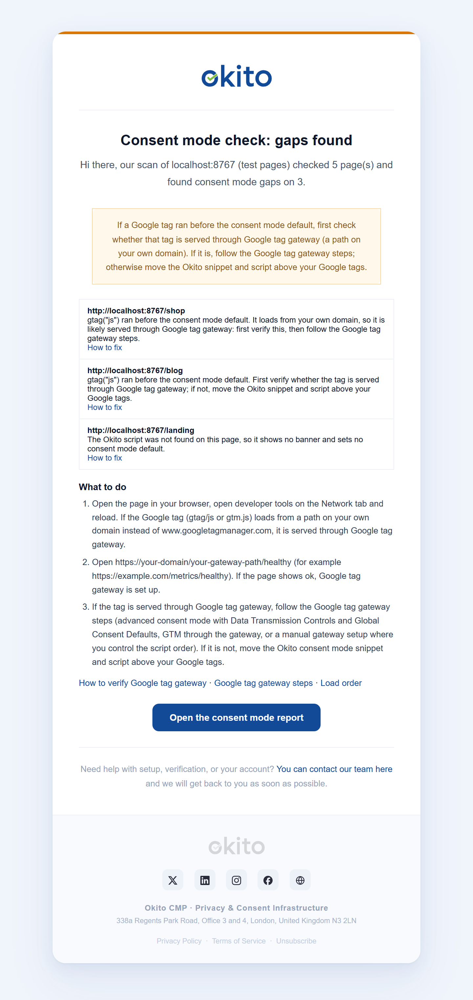

# Consent mode check

Every cookie scan also checks each page it opens, before any consent is given:

* whether the **Okito script** is on the page,
* whether the **consent mode default is set before the first Google tag**,
* whether a late Google tag is served from **your own domain** (Google tag gateway),
* in basic mode, whether a Google tag loaded before the visitor consented.

The check uses the Google tags mode your site runs: the one chosen in Banner Builder, except that on Free and Beginner plans Google tags run in [basic consent mode](basic-and-advanced.md) unless you turned consent mode off. In basic mode it confirms that Google tags wait for the visitor's consent.

A consent mode default set in Google Tag Manager's **Consent Initialization** (for example by the [Okito GTM template](../installation/google-tag-manager.md)) appears after `gtm.js` in the data layer, but GTM runs it before any other tag. It counts as on time when Google's consent state shows it was in time, or, with the Okito template, when no gtag.js command was queued ahead of it. This never applies when Google records that the default was set late.

Open **Consent mode check** in the dashboard to see the report page by page and run a new check. Scheduled scans run it automatically, and you get an email when a scan you start or a scheduled scan finds gaps. In the Shopify app, the check is in **Cookie Manager → Consent Mode**; see [Shopify](#shopify).

## The report

For each page, the report shows the result and a **How to fix** link:

| Result | Meaning | Fix |
| --- | --- | --- |
| **The consent mode default was set before the first Google tag.** | All good. | — |
| **The consent mode default was set in Google Tag Manager's Consent Initialization** | All good: the default came from a GTM tag on the Consent Initialization trigger, such as the Okito GTM template. | — |
| **Basic consent mode: Google tags wait for consent.** | All good. | — |
| **Late** | A Google tag ran before the consent mode default. | First verify whether the tag is served through Google tag gateway; if so follow the [GTG steps](google-tag-gateway.md), otherwise fix the [load order](load-order.md). |
| **Order held by chance** | Your Google tags were queued before the consent mode default. Okito put its default in front because it loaded before Google's script on this scan; on other page views Google's script can load first. | Put the Okito Consent Mode snippet above your Google tags ([load order](load-order.md)). |
| **No default** | Google tags run but no consent mode default was set. | Add the Consent Mode snippet or check the installation. |
| **Okito script missing** | The page has no banner and no consent mode default. The early blocker (`blocker.js`) on its own counts as missing. | Add the Okito code to that page (often pages built with a separate tool, such as a catalogue viewer or 3D tour). |
| **Basic mode: tag loaded before consent** | In basic mode, a Google tag loaded before the visitor consented. | [Mark the tag](../cookies-and-scripts/manual-script-marking.md) so Okito can hold it. |
| **No Google tag** | For information only. | — |
| **Consent mode off** | You turned Google consent mode off in Banner Builder, so pages are only checked for the Okito script. For information only. | — |

## Verify Google tag gateway yourself

The scan flags a late tag as *likely served through Google tag gateway* when it loads from your own domain. Always verify this yourself:

1. Open the page with your browser's developer tools on the **Network** tab and reload. If the Google tag (gtag/js or gtm.js) loads from a path on your own domain instead of `www.googletagmanager.com`, it is served through Google tag gateway.
2. Open `https://your-domain/your-gateway-path/healthy` (for example `https://example.com/metrics/healthy`). If it shows `ok`, the gateway is set up.
3. If it is served through Google tag gateway, follow the [Google tag gateway steps](google-tag-gateway.md). If not, move the Okito snippet and script above your Google tags.

## Email notification

When a scan you start or a scheduled scan finds gaps, the account owner gets an in-app notification and an email (unless compliance alerts are turned off in the notification settings). The scans Okito starts by itself for a new website (its first scan, and the scans that retry it) send neither: the banner may not be installed yet. The email lists each affected page with a **How to fix** link, the manual Google tag gateway verification steps above, and a link to the report.

## Run a check

Click **Check now** on the Consent mode check page. It runs a cookie scan (counted against your monthly scans) and updates the report when it finishes.

## Shopify

For a store connected through the Okito app, the check is in the app's **Cookie Manager → Consent Mode**, on every plan, with **Check now** there too. Each fix links to a setting in your Shopify admin: the Cookie banner app embed or **Settings → Customer events**. The email for a store says the same and opens the app in your Shopify admin. See [Shopify](../installation/shopify.md#consent-mode-check).
